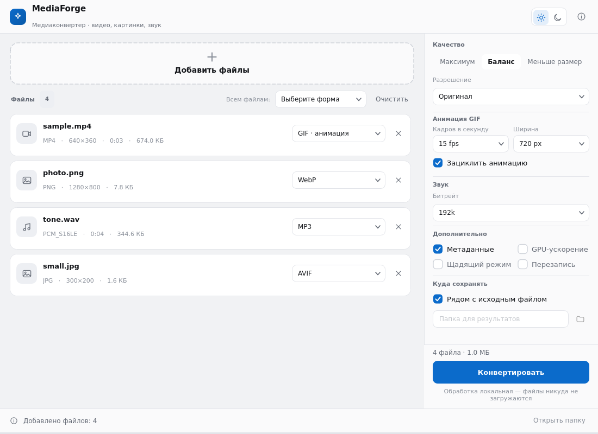
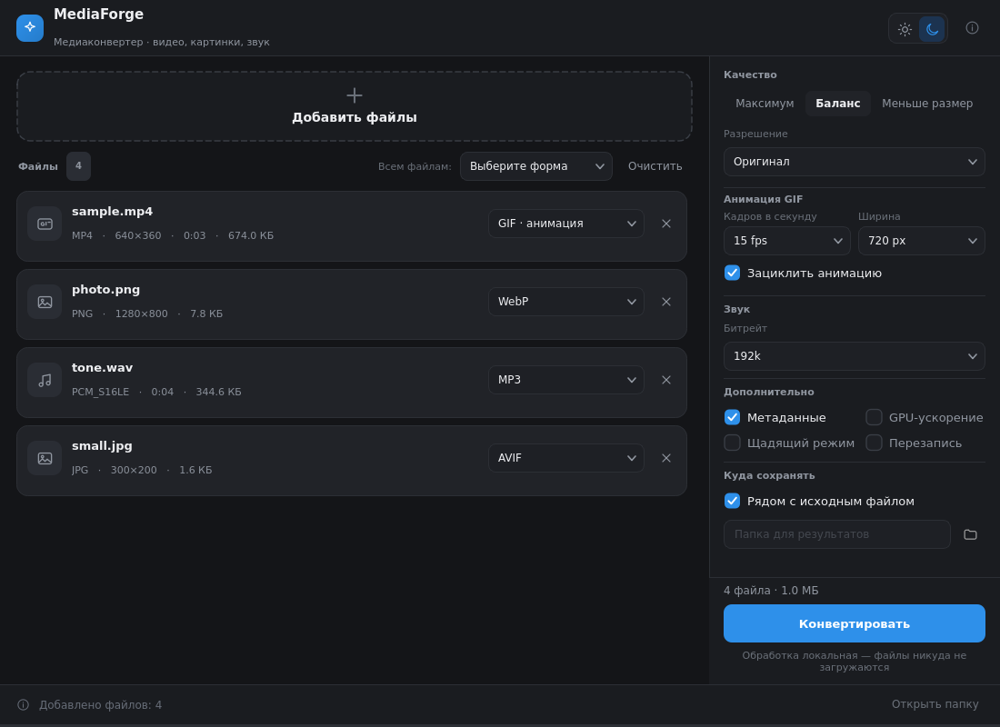

# MediaForge

**Портативный медиаконвертер для Windows 10/11** — видео, GIF, картинки и звук
в одном окне. Работает локально: ничего не устанавливает в систему и не отправляет
файлы в интернет.

| Светлая тема | Тёмная тема |
|---|---|
|  |  |

## Скачать и запустить

1. Скачайте `MediaForge-portable-win64.zip` со страницы [Releases](../../releases) (≈126 МБ).
2. Распакуйте архив целиком в любую папку — например, `C:\Tools\MediaForge`.
   Важно: всю папку, а не отдельные файлы.
3. Двойной клик по **`MediaForge.exe`** — всё. ffmpeg, Python и библиотеки уже внутри.

Установка и права администратора не нужны. Ярлык делается обычным способом:
правый клик по `MediaForge.exe` → «Отправить» → «Рабочий стол (создать ярлык)».

> Первый запуск может сопровождаться предупреждением SmartScreen об «неизвестном
> издателе» — сборка не подписана платным сертификатом. «Подробнее» →
> «Выполнить в любом случае».

## Что умеет

| Задача | Из чего | Во что |
|---|---|---|
| **Видео** | MP4, MKV, MOV, WebM, AVI, WMV, FLV, TS, M2TS, 3GP… | MP4 (H.264), MKV (H.265 / H.264), WebM (VP9), MOV, AVI |
| **Видео → GIF** | любое видео | GIF с настройкой FPS, ширины и зацикливания |
| **Звук из видео** | видео и аудио | MP3, M4A (AAC), WAV, FLAC, Opus, OGG |
| **Картинки** | PNG, JPEG, WebP, AVIF, BMP, TIFF, GIF, ICO, HEIC… | PNG, JPEG, WebP, AVIF, TIFF, BMP, GIF, ICO, PDF |

Ещё:

- перетаскивание файлов и папок прямо в окно, папки читаются рекурсивно;
- у каждого файла свой формат, плюс «Всем файлам» для массовой смены;
- качество: **Максимум / Баланс / Меньше размер** и ограничение разрешения (4K…480p);
- прогресс и скорость по каждому файлу, отмена на лету;
- **щадящий режим** — половина потоков CPU и по одному файлу за раз, если нужно
  работать параллельно и не мешать другим программам;
- **GPU-ускорение** (NVENC / Quick Sync / AMF): программа проверяет, что кодировщик
  реально работает, иначе тихо остаётся на CPU;
- светлая и тёмная тема; размер окна и настройки запоминаются.

## Как пользоваться

1. Перетащите файлы или папку в окно — либо нажмите на пунктирную область.
2. Справа выберите качество и разрешение. Для GIF появятся настройки анимации,
   для звука — битрейт.
3. В строке каждого файла выберите целевой формат. По умолчанию подставляется
   разумный: PNG/WebP для картинок, MP4 для видео, MP3 для звука.
4. Нажмите **«Конвертировать»**. Результаты появятся рядом с исходными файлами,
   если в блоке «Куда сохранять» не указана другая папка.

Если имя занято, к файлу добавится `(1)`, `(2)` — исходники не затираются,
пока не включён флажок «Перезапись».

### Горячие клавиши

| Клавиши | Действие |
|---|---|
| `Ctrl+O` | добавить файлы |
| `Ctrl+Enter` | начать конвертацию |
| `Esc` | остановить |
| `Ctrl+L` / `Ctrl+D` | светлая / тёмная тема |

## Настройки и следы в системе

Сборка портативная: настройки и геометрия окна лежат в папке `data\` **рядом
с программой**, поэтому её можно переносить на флешке вместе с настройками.
В реестр ничего не пишется, службы не создаются, после закрытия окна процессов
не остаётся. Удаление — просто удалить папку.

## Если что-то не работает

| Симптом | Что делать |
|---|---|
| SmartScreen ругается / антивирус удалил `MediaForge.exe` | запустить `MediaForge.cmd` — он делает то же самое |
| Окно не открывается | запустить `MediaForge-debug.cmd`: в консоли будет текст ошибки |
| «Рядом с MediaForge.exe нет папки python» | архив распакован частично — распакуйте целиком |
| Видео не открывается после конвертации | выберите MKV · H.264 или MP4 (H.264) |
| Нужно проверить окружение | `MediaForge-check.cmd` покажет версии Python, PySide6 и ffmpeg |

Подробный лог ошибок приложения пишется в `%TEMP%\mediaforge-error.log`.

## Командная строка

Для автоматизации есть консольный режим (из исходников):

```bash
python -m mediaforge.cli video.mp4 --to gif --fps 12 --width 640
python -m mediaforge.cli photo.png --to avif --quality small --out ./out
python -m mediaforge.cli movie.mkv --to mp3 --bitrate 320k
python -m mediaforge.cli ./photos --to webp -r 1080 --gentle
```

## Другие системы и сборка из исходников

Код кроссплатформенный (Qt + ffmpeg): на Linux и macOS запускается из исходников —
`./start.sh` либо `pip install -r requirements.txt && python -m mediaforge`.
Нужен установленный `ffmpeg` (`apt install ffmpeg`, `brew install ffmpeg`).

Для разработчика — архитектура, тесты, сборка `.exe` и portable-архива:
**[docs/DEVELOPMENT.md](docs/DEVELOPMENT.md)**.

## Нагрузка на систему

Интерфейс занимает ~80 МБ ОЗУ и почти не грузит CPU в покое. Тяжёлая работа идёт
в отдельном процессе `ffmpeg`, одновременно конвертируется 1–2 файла
(в «щадящем режиме» — один). Никакой телеметрии и сетевых запросов.

## Лицензия

Код — [MIT](LICENSE). `ffmpeg` внутри сборки распространяется под GPL, его
исходники — на [ffmpeg.org](https://ffmpeg.org). Qt/PySide6 — LGPL.
